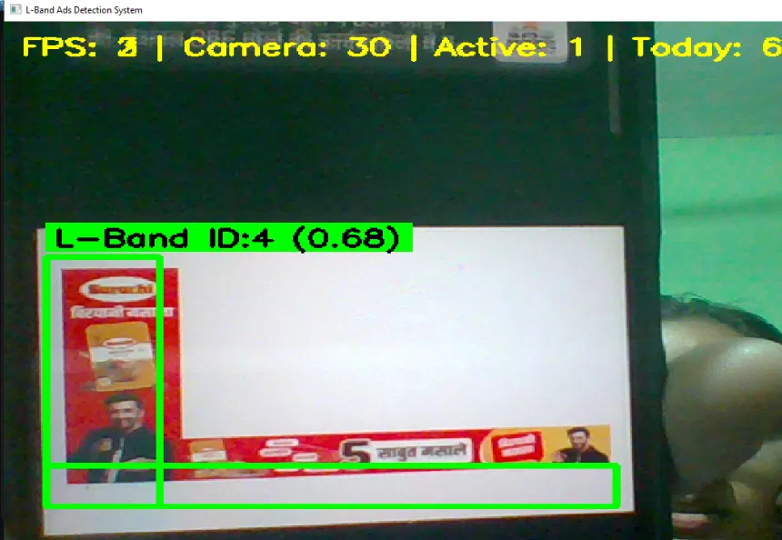
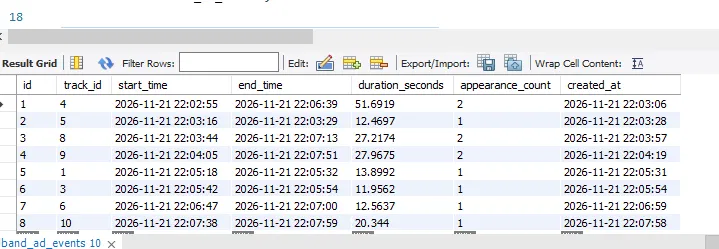

# 📺 L-Band Advertisement Detection & Tracking System

A real-time computer vision system that detects, tracks, and logs **L-shaped television advertisements** (L-Band Ads) from a live camera feed. Built with **YOLOv11 + DeepSORT + OpenCV + FastAPI + MySQL**.


---

## 📖 Table of Contents

- [About](#about)
- [Features](#features)
- [System Architecture](#system-architecture)
- [Tech Stack](#tech-stack)
- [Project Structure](#project-structure)
- [Prerequisites](#prerequisites)
- [Installation](#installation)
- [Database Setup](#database-setup)
- [Configuration](#configuration)
- [Usage](#usage)
- [API Endpoints](#api-endpoints)
- [Database Schema](#database-schema)
- [How It Works](#how-it-works)
- [Results](#results)
- [Troubleshooting](#troubleshooting)
- [License](#license)

---

## About

**L-Band Ads** are L-shaped graphical overlays that TV channels display on-screen during broadcasts — typically a vertical bar on the left and a horizontal bar at the bottom, forming an "L" shape. They are commonly used for promotional or sponsored content.

This system captures a live TV broadcast through a webcam, automatically detects when an L-Band ad appears, tracks it across frames with a unique ID, measures how long it stays on-screen, and logs every occurrence to a MySQL database — enabling analysis of ad frequency, duration, and patterns.

---

## Features

| Feature | Description |
|---|---|
| **Real-Time Detection** | YOLOv11 object detection model trained specifically on L-Band advertisements |
| **Multi-Object Tracking** | DeepSORT tracker assigns persistent IDs to each ad across frames |
| **L-Shaped Bounding Box** | Custom L-shaped visual annotation that mirrors the actual ad shape |
| **Smart Logging** | Tracks daily ad appearances per ID — updates existing rows instead of duplicating |
| **REST API** | FastAPI-powered endpoints for health checks, statistics, and recent events |
| **Live Dashboard Overlay** | On-screen FPS, active ads count, and daily occurrence statistics |
| **Multi-Threaded Pipeline** | Separate threads for camera capture, detection, tracking, and display |
| **Auto-Recovery** | Camera reconnection on failure with configurable retry limits |
| **Rotating Logs** | File-based logging with automatic rotation (10 MB max, 5 backups) |

---

## System Architecture

```
┌─────────────┐    ┌──────────────┐    ┌──────────────┐    ┌───────────┐
│   Camera     │───▶│   YOLO v11   │───▶│   DeepSORT   │───▶│  Display  │
│  Capture     │    │  Detector    │    │   Tracker    │    │  Window   │
│  (Thread 1)  │    │  (Thread 2)  │    │  (Thread 3)  │    │  (Main)   │
└─────────────┘    └──────────────┘    └──────────────┘    └───────────┘
                                              │
                                              ▼
                                       ┌──────────────┐    ┌───────────┐
                                       │   MySQL DB   │    │  FastAPI   │
                                       │  (Logging)   │    │  (REST)   │
                                       └──────────────┘    └───────────┘
```

**Data Flow:**
1. **Camera Thread** → captures frames at 30 FPS → pushes to `frame_queue`
2. **Detection Thread** → pulls frames → runs YOLO inference → pushes to `detection_queue`
3. **Tracking Thread** → pulls detections → updates DeepSORT → draws L-boxes → logs to MySQL → pushes annotated frames to `result_queue`
4. **Main Thread** → displays annotated frames with info overlay

---

## Tech Stack

| Component | Technology | Purpose |
|---|---|---|
| Object Detection | **Ultralytics YOLOv11n** | Detect L-Band ad regions |
| Object Tracking | **DeepSORT** (MobileNetV2 embedder) | Persistent ID assignment across frames |
| Computer Vision | **OpenCV 4.8** | Camera I/O, frame processing, display |
| Deep Learning | **PyTorch 2.0** | Model inference backend |
| Web API | **FastAPI + Uvicorn** | REST endpoints for monitoring |
| Database | **MySQL 8.0** | Event logging and analytics |
| Language | **Python 3.11** | Core application |

---

## Project Structure

```
l_band_detection/
│
├── app.py                  # Main application entry point & orchestrator
├── config.py               # All configuration constants
├── camera.py               # Camera capture module (threaded)
├── detector.py             # YOLO v11 detection module
├── tracker.py              # DeepSORT tracking + L-shape drawing
├── database.py             # MySQL database operations
├── schema.sql              # Database schema definition
├── lband_best_model.pt     # Trained YOLOv11 model weights
├── requirements.txt        # Python dependencies
├── lband_detection.log     # Application log file (auto-generated)
├── README.md               # This file
│
└── .vscode/
    ├── settings.json       # VS Code Python interpreter config
    └── launch.json         # VS Code debug configuration
│
└── docs/
   ├── database_output.png
   └──detection_result.png

```

---

## Prerequisites

- **Python** 3.10 or higher
- **MySQL Server** 8.0 or higher
- **Webcam** (built-in or USB)
- **Windows 10/11** (tested; Linux/macOS may require config changes)

> **Note:** The system runs on CPU by default. A CUDA-compatible GPU is optional but recommended for higher FPS.

---

## Installation

### 1. Clone the Repository

```bash
git clone https://github.com/<your-username>/l-band-detection.git
cd l-band-detection
```

### 2. Create a Virtual Environment

```bash
python -m venv venv

# Windows
.\venv\Scripts\activate

# Linux/macOS
source venv/bin/activate
```

### 3. Install Dependencies

```bash
pip install -r requirements.txt
```

### 4. Verify the Model File

Ensure `lband_best_model.pt` is present in the project root directory. This is the pre-trained YOLOv11 model — **do not modify or retrain** this file.

---

## Database Setup

### Option A: Automatic (Recommended)

The application automatically creates the database table on first run. Just ensure MySQL is running and the credentials in `config.py` are correct.

### Option B: Manual

```bash
mysql -u root -p < schema.sql
```

### Default MySQL Configuration (in `config.py`)

```python
DATABASE_CONFIG = {
    'host': 'localhost',
    'user': 'root',
    'password': 'your_password',
    'database': 'lband_ads',
    'pool_size': 5
}
```

> ⚠️ **Important:** Update the `password` field in `config.py` with your MySQL root password before running.

---

## Configuration

All settings are centralized in [`config.py`](config.py):

| Section | Key Settings |
|---|---|
| **Camera** | `source` (device index), `fps`, `width`, `height`, `backend` |
| **YOLO** | `confidence_threshold` (0.18), `min_box_width/height` (120px), `single_detection_mode` |
| **DeepSORT** | `max_age` (30 frames), `n_init` (3 frames), `max_cosine_distance` (0.3) |
| **L-Shape Box** | `vertical_ratio`, `horizontal_ratio`, `color`, `thickness` |
| **API** | `host`, `port` (8000) |
| **Logging** | `level`, `log_to_file`, `max_bytes`, `backup_count` |

---

## Usage

### Start the System

```bash
python app.py
```

### What Happens on Startup

```
[INFO] ============================================================
[INFO] L-BAND ADS DETECTION SYSTEM
[INFO] ============================================================
[INFO] [WAIT] Waiting for system initialization...
[INFO] [OK] Database connection pool initialized
[INFO] [OK] Database schema validated/created
[INFO] [LOADING] Loading YOLO11 model from: .../lband_best_model.pt
[INFO] [OK] L-Band detector initialized successfully
[INFO] [LOADING] Initializing DeepSORT tracker...
[INFO] [OK] L-Band tracker initialized successfully
[INFO] [OK] Camera opened: 640x480 @ 30fps
[INFO] [OK] System started successfully
[INFO] Uvicorn running on http://127.0.0.1:8000
```

### Controls

| Key | Action |
|---|---|
| `Q` | Quit the application |
| `X` button | Close the display window (also stops the app) |
| `Ctrl+C` | Force stop from terminal |

---

## API Endpoints

The system exposes a REST API on `http://127.0.0.1:8000`:

| Method | Endpoint | Description |
|---|---|---|
| `GET` | `/` | Health check — system status, uptime, queue sizes, daily count |
| `GET` | `/statistics` | Detailed statistics — detector, tracker, and database metrics |
| `GET` | `/recent-events?limit=10` | Most recent L-Band ad events from the database |

### Example Response — Health Check

```json
{
  "status": "running",
  "uptime_seconds": 125.3,
  "camera_fps": 30,
  "queues": {
    "frame_queue": 1,
    "detection_queue": 0,
    "result_queue": 2
  },
  "active_ads": 1,
  "daily_occurrences": 5,
  "stats": {
    "total_frames": 3750,
    "total_detections": 42,
    "total_tracks": 5,
    "start_time": "2026-11-21T16:00:00"
  }
}
```

---

## Database Schema

**Table: `lband_ad_events`**

| Column | Type | Description |
|---|---|---|
| `id` | INT (PK, Auto) | Unique event ID |
| `track_id` | INT | DeepSORT tracking ID |
| `start_time` | DATETIME | When the L-Band first appeared |
| `end_time` | DATETIME | When the L-Band disappeared (or last seen) |
| `duration_seconds` | FLOAT | Total cumulative on-screen time (seconds) |
| `appearance_count` | INT | Number of times this track_id appeared today |
| `created_at` | TIMESTAMP | Record creation timestamp |

### Smart Logging Logic

- **Same `track_id` + Same day** → Updates the existing row in-place: increments `appearance_count`, adds to `duration_seconds`, updates `end_time`.
- **Same `track_id` + New day** → Creates a new row with `appearance_count = 1`.
- **New `track_id`** → Creates a new row with `appearance_count = 1`.

This ensures one row per unique ad per day, with cumulative stats.

---

## How It Works

### 1. Detection Strategy

The YOLO model detects L-Band ad regions. To handle domain shift (model trained on clean screenshots, but inference runs on a webcam pointed at a TV screen), the system uses:

- **Low confidence threshold** (0.18) — catches the full L-band even with glare/perspective distortion
- **Minimum size filter** (120×120 px) — rejects small false-positive patches
- **Single detection mode** — selects only the **largest** bounding box by area, ensuring one L-Band per frame

### 2. Tracking Strategy

DeepSORT with MobileNetV2 appearance embeddings assigns persistent IDs:

- `n_init = 3` — a track is confirmed only after 3 consecutive detections
- `max_age = 30` — a track survives 30 frames without detection before being deleted
- When a track disappears, its duration and metadata are logged to MySQL

### 3. L-Shaped Bounding Box

Instead of a standard rectangle, the system draws an **L-shaped** annotation:

```
┌──────┐
│      │
│  V   │
│  E   │
│  R   │
│  T   │
│      │
├──────┴──────────────────┐
│     HORIZONTAL BAR      │
└─────────────────────────┘
```

The vertical and horizontal bar ratios are configurable in `LSHAPE_CONFIG`.

### 4. Thread-Safe Database Writes

Uses `SELECT ... FOR UPDATE` row locking with explicit transactions to prevent race conditions when multiple threads attempt to log the same `track_id` simultaneously.

---


## Results

### Live Detection Output

The application detects the L-Band advertisement from the webcam feed, draws the L-shaped annotation around it, and assigns a persistent tracking ID. The top bar shows live statistics: FPS, camera frame rate, number of active ads, and today's total occurrences.



| Overlay Element | Meaning |
|---|---|
| `L-Band ID:4 (0.68)` | Tracking ID 4, detection confidence 0.68 |
| `FPS` | Processing speed of the pipeline |
| `Camera: 30` | Camera feed rate in frames per second |
| `Active: 1` | Number of ads currently on screen |
| `Today: 6` | Total appearances logged today |

### Database Output

Each tracked ad is stored in the `lband_ad_events` table. The screenshot below shows the logged records for one day.



| id | track_id | start_time | end_time | duration_seconds | appearance_count | created_at |
|---|---|---|---|---|---|---|
| 1 | 4 | 2026-11-21 22:02:55 | 2026-11-21 22:06:39 | 51.6919 | 2 | 2026-11-21 22:03:06 |
| 2 | 5 | 2026-11-21 22:03:16 | 2026-11-21 22:03:29 | 12.4697 | 1 | 2026-11-21 22:03:28 |
| 3 | 8 | 2026-11-21 22:03:44 | 2026-11-21 22:07:13 | 27.2174 | 2 | 2026-11-21 22:03:57 |
| 4 | 9 | 2026-11-21 22:04:05 | 2026-11-21 22:07:51 | 27.9675 | 2 | 2026-11-21 22:04:19 |
| 5 | 1 | 2026-11-21 22:05:18 | 2026-11-21 22:05:32 | 13.8992 | 1 | 2026-11-21 22:05:31 |
| 6 | 3 | 2026-11-21 22:05:42 | 2026-11-21 22:05:54 | 13.9562 | 1 | 2026-11-21 22:05:54 |
| 7 | 6 | 2026-11-21 22:06:47 | 2026-11-21 22:07:00 | 12.5637 | 1 | 2026-11-21 22:06:59 |
| 8 | 10 | 2026-11-21 22:07:38 | 2026-11-21 22:07:59 | 20.344 | 1 | 2026-11-21 22:07:58 |

### Summary of This Run

| Metric | Value |
|---|---|
| Unique tracks logged | 8 |
| Total appearances (`appearance_count`) | 11 |
| Total on-screen time (`duration_seconds`) | ≈ 180.11 seconds |
| Longest cumulative display | Track 4, 51.69 seconds |


## Troubleshooting

| Problem | Solution |
|---|---|
| Camera window closes immediately | Check if another app is using the webcam; try changing `source` in `config.py` |
| No detections | Ensure the L-band ad is clearly visible to the webcam; adjust `confidence_threshold` |
| Multiple small boxes instead of one | Verify `single_detection_mode: True` and `min_box_width/height` ≥ 120 in `config.py` |
| MySQL connection refused | Ensure MySQL server is running; verify credentials in `config.py` |
| `CUDA not available` warning | Normal on CPU — the system works fine without a GPU, just slower (~2-3 FPS) |
| L-box extends off-screen | This was fixed — ensure you're running the latest code |

---

## License

This project is developed for academic/research purposes. All rights reserved.

---

<p align="center">
  Built with ❤️ using YOLOv11 • DeepSORT • OpenCV • FastAPI • MySQL
</p>
